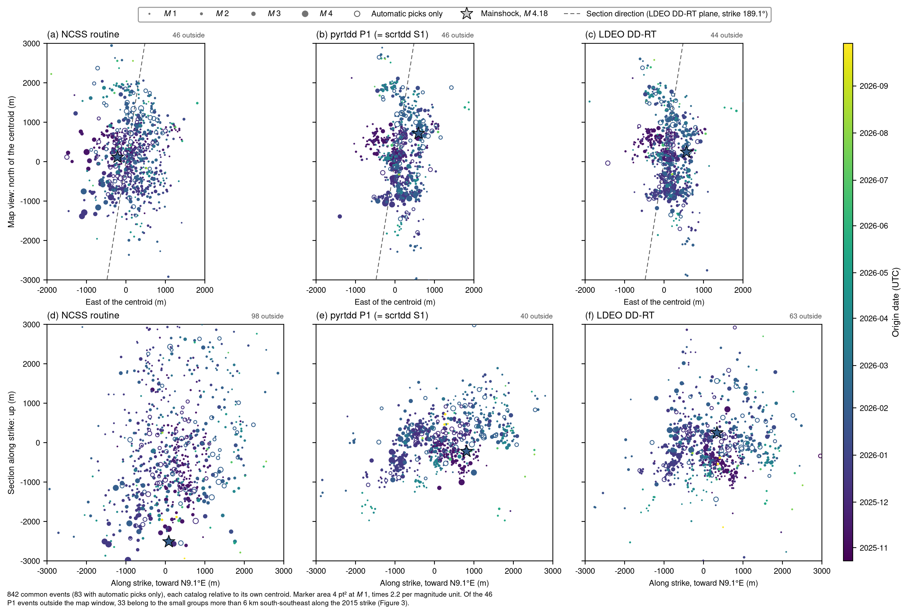
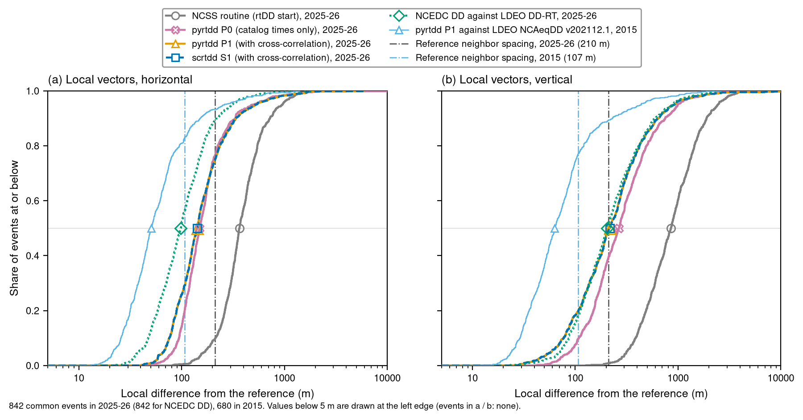
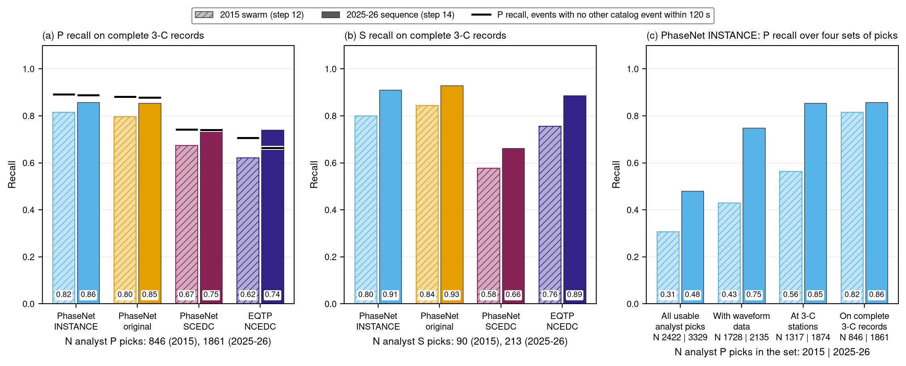

# Summary

We repeated the 2015 San Ramon test on the 2025-26 San Ramon sequence (California), with unchanged settings:

- SED's double-difference relocator **rtDD**, both as scrtdd (SeisComP) and as pyrtdd (Python);
- SED's deep-learning picker **scdlrtpicker**.

The data are public NCEDC data: 927 events, 41,870 analyst and automatic picks, and waveforms of 26 test events.

- **rtDD runs unchanged and gives the same answer in both forms.**
  - scrtdd and pyrtdd agree to a median of 1 m, and 97.8 % of their cross-correlation lags are identical.
  - 893 of the 927 events were relocated. The 34 dropped events have fewer than 8 picks, and most of them are unreviewed.
- **rtDD sharpens the routine catalog about 2.4 times, but cross-correlation helps much less than in 2015.**
  - Against Lamont's real-time double-difference catalog, the local geometry is off by a median of 142 m horizontal
    and 217 m vertical (2015: 51 / 63 m against Lamont's cross-correlation re-analysis).
  - The causes cannot be separated with these data:
    - the yardstick is weaker this time (a real-time solution, with events twice as sparse);
    - the sequence is wider;
    - the station network is different;
    - the waveform correlations are poorer.
- **The new sequence did not reactivate the 2015 fault strand.**
  - It lies on a parallel strand about 2 km east of the 2015 fault plane, at the same depth.
  - Its main body is 1.8-4.7 km SSE of the 2015 swarm along strike.
  - Only 8 of its 893 relocated events lie within 500 m of the 2015 plane.
- **The DL picker behaves exactly as in 2015, and the data are now better for it.**
  - On isolated events the PhaseNet models find the same share of analyst P picks in both years (0.89 for `phasenet_instance`).
  - Because the strong-motion records are now continuous, `phasenet_instance` finds 85 % of the analyst P picks at
    3-component stations (2015: 56 %), with a median timing difference of about 0.03-0.05 s.
- **What to watch for.**
  - rtDD's absolute depth is again about 2.4 km too deep, so use only the relative geometry.
  - Unreviewed (automatic) events cause the few runaway relocations.
  - The picker loses one of two events that are only a few seconds apart.

# 1. The sequence and the data

- **Timing.** The swarm began in November 2025, peaked in November-December 2025 and February 2026, and continues at a low rate.
  Its largest event is the **Mw 4.18 of 2026-02-02 15:01:13 UTC** (nc75305736), 4 km SE of San Ramon.
- **USGS forecast.** USGS's aftershock forecast (issued 2026-10-12) treats it as a swarm ("a forecast based solely on aftershock processes
  can not capture all of the characteristics of the more complex behavior of a swarm"). Its fitted model has p = 1.15
  and b = 1.0, and it gave a 4 % chance of an M 3+ event in the following month.

| | 2015 swarm | 2025-26 sequence |
|---|---|---|
| period | Oct-Nov 2015 | 2025-10-01 to 2026-10-18 |
| events (NCSS routine or NCEDC DD location in the box) | 685 | 927 |
| picks used by rtDD (P / S) | 25,684 (22,545 / 3,139) | 41,870 (37,929 / 3,941) |
| events with automatic picks only | 0 | 98 |
| largest event | Mw 3.6 (nc72540765) | Mw 4.18 (nc75305736) |
| independent reference | Lamont NCAeqDD v202112.1 (cross-correlation re-analysis) | Lamont DD-RT v202201 (real-time DD) |
| velocity model | NCSS CON, Vp/Vs 1.73 | the same (NCSS still uses CON here) |

- **Data used.** Everything comes from NCEDC:
  - the NCSS catalog with phase picks, StationXML, and 62,246 cross-correlation windows;
  - for the picker, 26 test events with 4 min of data at all stations within 80 km.
- **One notable difference from 2015:** only 91 stations within 60 km are common to both years.

# 2. Relocation

- **The runs.** The same four runs as in 2015, with the same settings:
  - P0 / S0 used catalog times only;
  - P1 / S1 also used waveform cross-correlation (1.5-15 Hz, P on the vertical, S on both horizontals combined).
  - P = pyrtdd, S = scrtdd.
- **What the distances mean.**
  - *Relative* error: an event's position after removing each catalog's centroid.
  - *Local* error: the error in the vectors from each event to its 10 nearest neighbors, i.e. how well the small-scale structure is
    reproduced.

| median difference from Lamont's DD catalog (m), horizontal / vertical | 2015 relative | 2015 local | 2025-26 relative | 2025-26 local |
|---|---|---|---|---|
| NCSS routine (the start) | 229 / 394 | 292 / 506 | 307 / 730 | 365 / 853 |
| rtDD, catalog times only (P0 = S0) | 142 / 134 | 137 / 147 | 167 / 274 | 149 / 265 |
| rtDD with cross-correlation (P1 = S1) | 97 / 106 | 51 / 63 | 145 / 311 (233*) | 142 / 217 |
| NCEDC DD catalog, for scale | 162 / 236 | 190 / 241 | 74 / 158 | 98 / 204 |

\* with the median offset removed instead of the mean; about 16 runaway events shift P1's mean depth.

- **rtDD again improves the routine catalog.** 77 % of the events end closer to the reference than they started, 94 % in local geometry,
  and the 3-D improvement is about 2.4 times. But cross-correlation reduces the local errors by only 5 % (horizontal)
  and 18 % (vertical), where in 2015 it roughly halved them.
- **Why we cannot say whether rtDD or the reference is at fault.**
  1. **A weaker yardstick.** Lamont's real-time catalog places each new event against older reference events in real time;
     it is not a joint cross-correlation re-analysis like 2015's. Its events are also twice as far apart (210 m against 107 m).
  2. **A wider sequence.** Event pairs are a median of 1.04 km apart (2015: 0.77 km).
  3. **A different network,** with fewer near-field stations.
  4. **Poorer correlations:**
     - 54 % of the P pairs reach |CC| ≥ 0.7 (2015: 58 %), and 23 % of the accepted P values are negative;
     - the accepted lags are longer;
     - the final residual spread is 21 ms (2015: 13 ms).
- **The two DD catalogs agree better with each other than with rtDD,** but both are real-time solutions tied to the same base
  catalog, so that agreement is not an independent check.
- **Absolute position.** rtDD's default solver again puts the cluster about 2.4 km too deep and 1.3 km too far west. Only the
  relative geometry should be used.
- **Runtime** (one CPU core): about 1.5-2 min without cross-correlation, and 29 min (scrtdd) / 38 min (pyrtdd) with it.

# 3. Where the new sequence lies relative to the 2015 swarm

- **Method.** Each year's rtDD solution (P1) was shifted by its own mean offset against its Lamont reference, so both sit in Lamont's
  common frame.
- **Check.** The same picture follows from the two Lamont catalogs alone.

- **Position.** The new centroid lies 4.1 km from the 2015 centroid, toward the SSE (azimuth 147°), at the same depth (7.1 km against 7.2 km).
- **Not the 2015 strand.** 846 of the 893 events lie more than 1 km east of the 2015 fault plane, and only 8 lie within 500 m of it.
- **A parallel structure.** The main body (835 events) lies on a structure parallel to the 2015 strand, within 2-5° of strike. A small
  cluster of five 2015 events at the south-east edge of that swarm already lay on this structure.
- **Small groups further SW.** 24 events sit about 8-9 km SW along strike at 7.8 km depth, and 9 shallower events sit at 4.5 km depth.

# 4. Deep-learning picker

- **Setup.** The same four models and settings as in 2015, on 26 analyst-reviewed events (M 0.6-4.18), compared with the
  analysts' picks.
- **What recall means.** Recall is the share of analyst picks the model also finds, within 0.5 s for P and 1.0 s for S.

| `phasenet_instance` | 2015 | 2025-26 |
|---|---|---|
| P recall: all analyst picks / with data / at 3-C stations / complete records | 0.31 / 0.43 / 0.56 / 0.82 | 0.48 / 0.75 / 0.85 / 0.86 |
| P recall, events with no other event within 120 s | 0.89 | 0.89 |
| S recall, complete records | 0.80 | 0.91 |
| false P picks per station-hour | 1.08 | 0.87 |
| complete station-event records | 54 % | 99 % |

- **Same models, changed data.**
  - On isolated events the three PhaseNet models score exactly as in 2015 (0.89 / 0.88 / 0.74). The models behave the same.
  - In 2015, 46 % of the station records were triggered strong-motion records that started too late for the picker's detector; now
    99 % of the records are continuous.
- **Which model.** `phasenet_instance` remains the best P picker, with the fewest false picks.
  - The fixed ranking rule names `phasenet_scedc` this time. It wins only because it makes the fewest S picks, scored against
    just 229 analyst S picks; it has the lowest P and S recall of the PhaseNet models.
- **Close event pairs still lose one event.** With one P per analysis window and a dead time, PhaseNet keeps the larger
  Mw 3.77 and loses the event 5.5 s before it.
- **First-motion polarity (`eqtp_ncedc`, normally oriented channels).**
  - At the plugin's default confidence of 0.5 it labels 88 % of the analyst first motions and agrees with 89 % of them.
  - At confidence 0.7 it labels 72 % and agrees with 93 %.
  - On boreholes with an inverted vertical channel, the analyst first motions follow the raw counts, so those 26 pairs disagree.
  - The model costs 22-25 times more CPU than PhaseNet.
- **Data and network quirks found.**
  - At the station nearest the swarm (NC.CSR), the binding rule picks a broadband sensor that started only on 2026-02-04. 20 earlier events lose that station, although its accelerometer picks well.
  - Three accelerometers have StationXML epochs that the picker cannot assemble into three components.

# 5. What this means

- **The tools work unchanged on a new sequence,** with a different station network, two years of archive and unreviewed events,
  and scrtdd and pyrtdd stay interchangeable. One caveat: stock pyrtdd still needs our filtering workaround.
- **The cross-correlation gain is not guaranteed.** It was large for the compact, well-recorded 2015 swarm against a
  re-analysis catalog. It is small here, and a stronger reference (a future Lamont re-analysis covering 2025-26) would be
  needed to judge rtDD's precision on this sequence.
- **Practical settings for a sequence like this:**
  - relocate only analyst-reviewed events, or at least check automatic ones;
  - judge rtDD only on relative geometry, or anchor it with better absolute travel times (station corrections);
  - use `phasenet_instance` for picking, and `eqtp_ncedc` only where polarity is needed, at confidence 0.7;
  - bind the sensor that covers the whole period at each station.
- **Seismological result.** The 2025-26 activity occurred on a separate, parallel strand of the San Ramon swarm zone, not on
  the 2015 one.

# 6. Caveats

- **The reference.** Lamont's real-time DD catalog is a real-time product, and NCEDC DD is tied to the same base catalog, so the two are not independent.
- **Picks.** 98 events have automatic picks only, and the near-station S picks arrive late against the model (median S-P
  residual about +0.3 s). These cancel in double differences but bias absolute depths.
- **Picker sample.** The picker test has 26 events (4 per magnitude bin), and the analyst picks are incomplete, so its precision is a lower bound.

# 7. Where to find everything

All paths are relative to the project folder (`/home/msseo/works/74.SeisComP_rtDD_DLpicker`).

- **Clean notebooks (key figures only):**
  - `notebooks/08_sanramon2026_relocation.ipynb`
  - `notebooks/09_sanramon2026_dlpicker.ipynb`
- **Full result notes:**
  - `docs/results/13_sanramon2026_relocation.md`
  - `docs/results/14_sanramon2026_dlpicker.md`
- **Data preparation:**
  - `docs/sanramon2026_inputs.md`
  - `docs/sanramon2026_waveforms.md`
  - the folder `data/sanramon_2026/`
- **Run scripts and outputs:** `runs/sanramon2026/`, with sub-folders `pyrtdd`, `scrtdd`, `analysis` and `dlpicker`.
- **The 2015 test, for comparison:** notebooks 06 and 07, and the notes `docs/results/11_*.md` and `12_*.md`.

*Data: NCEDC (doi:10.7932/NCEDC); NCSS; Lamont-Doherty Earth Observatory double-difference catalogs; USGS ComCat.*
